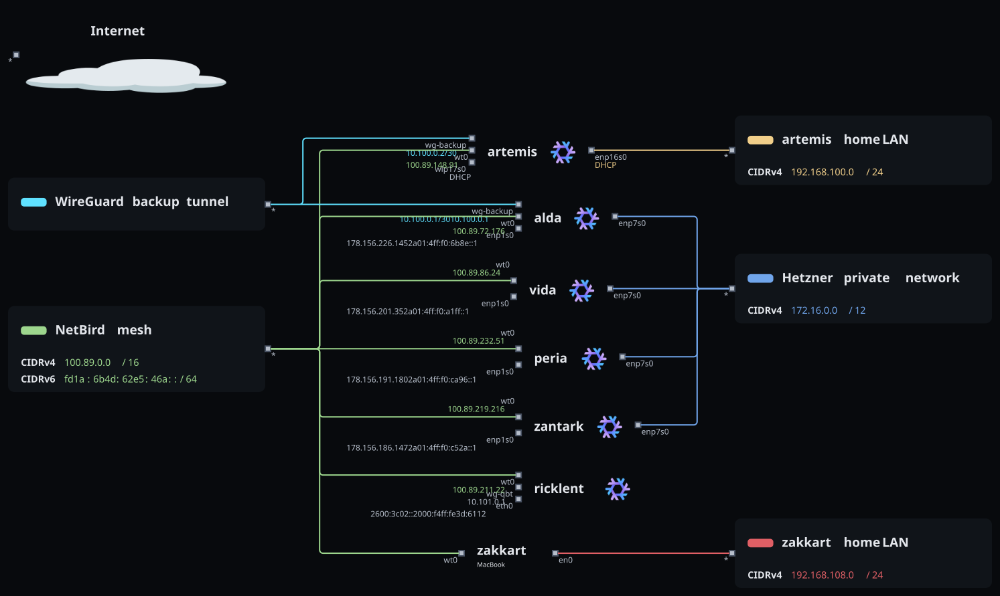

# cornn flaek

Personal Nix flake for `artemis` (headless NixOS gaming and streaming box),
`zakkart` (nix-darwin MacBook), and the Legion servers (`alda`, `vida`,
`zantark`, `peria`; Hetzner Cloud).

The networks connecting every host.

The hosts, their services, and the connections between them.

- [`AGENTS.md`](AGENTS.md): layout, operation, and the decisions that
  constrain changes.
- [`docs/runbooks/`](docs/runbooks/): restore, binary cache, wallpaper, and
  zakkart bootstrap procedures.
- [`ACKNOWLEDGEMENTS.md`](ACKNOWLEDGEMENTS.md): project name and source
  credits.

omp's model roles and per-agent overrides are declared in
`modules/packages/omp.nix`. The task tool does not expose per-spawn effort
(`task.enableEffort = false`); thinking levels stay in configured model roles
and agent definitions. Scout and sonic use medium through per-agent role
overrides, while the custom smol worker keeps the role's high setting.

## TLS trust

`modules/nix.nix` applies the eMudhra and legacy AAA root distrust to the
shared nixpkgs CA package and zakkart's Nix-managed system bundle. Rebuilt
Go applications use the patched Go 1.26 toolchain, including the separately
packaged f95-tracker service. Remove the compiler override when the pinned
nixpkgs input supplies Go 1.26.10 or newer.

These changes take effect only after rebuilding and activating each host.
They do not change Apple's Keychain or the trust stores shipped inside
independent applications such as Helium. Those clients require their own
updates and verification. See the [Mozilla incident advisory](https://blog.mozilla.org/security/2026/10/20/protecting-firefox-users-following-the-compromise-of-emudhra-intermediate-certificates/)
and [Go security release notice](https://groups.google.com/g/golang-announce/c/66pojueaQek).
