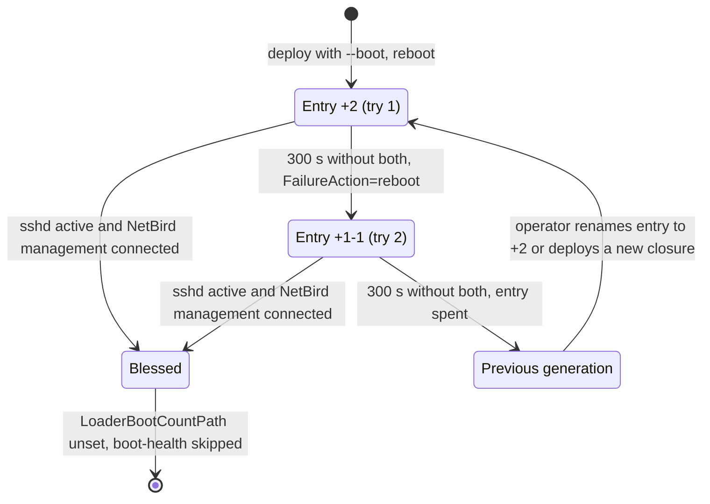
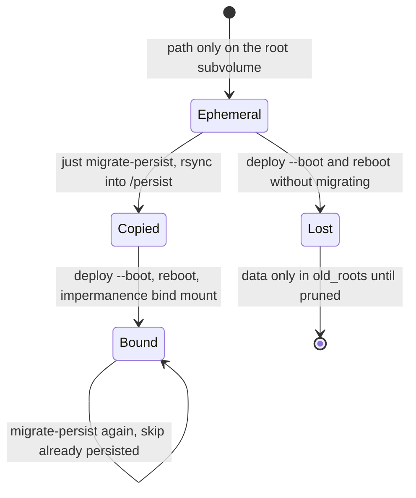
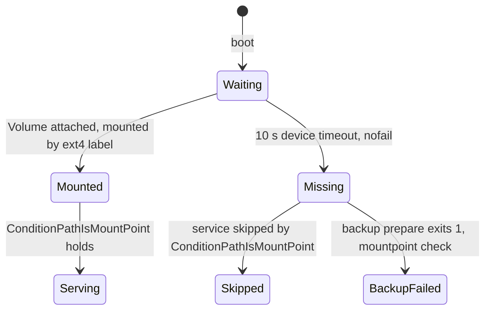
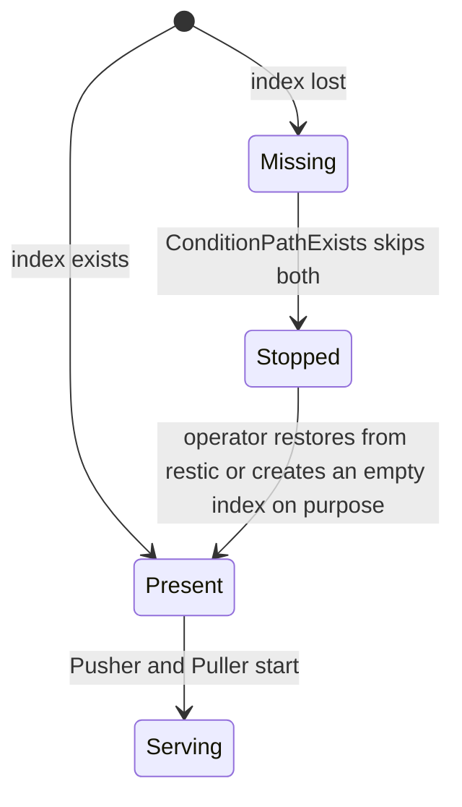
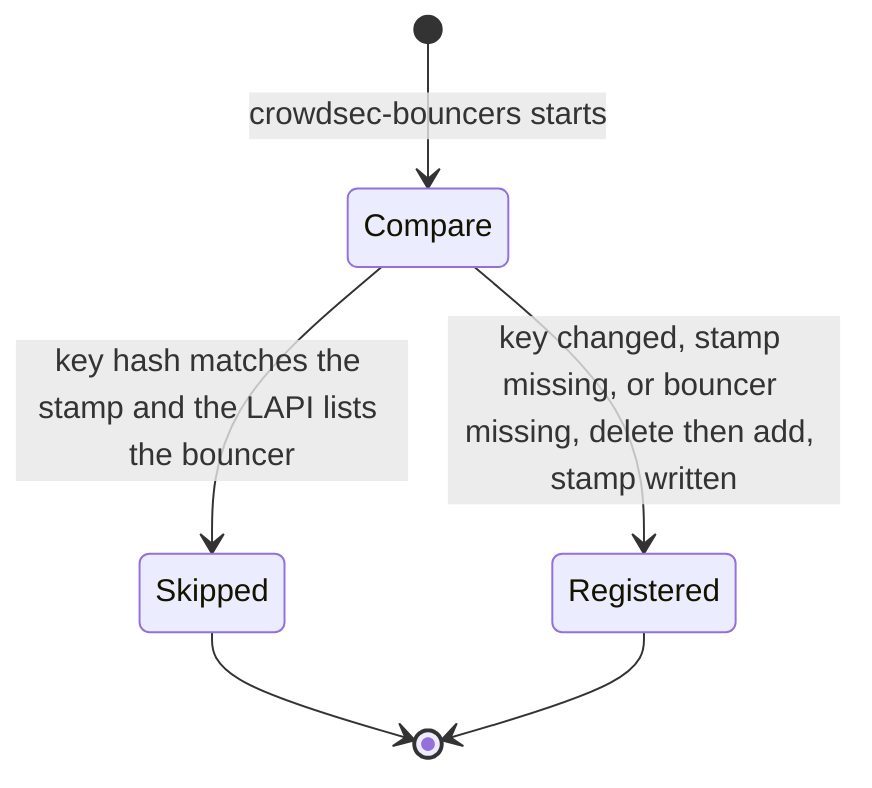

# State machines

These state machines span several files or hosts, and none declares its
state in one place: it lives in a file's presence, a unit's active state, an
EFI variable, a stamp, or a data file. Each diagram answers one question: what
states can this thing be in, and what moves it between them. The sources under
each diagram are where to check it against the code.

## Boot counting and blessing

What decides whether a new generation stays?

Sources: `modules/hosts/artemis/boot-health.nix`, AGENTS.md "Deploying".

## Persistence of one path

How does a path become persistent without losing its data?

Sources: `modules/impermanence.nix`, `modules/hosts/artemis/migrate-persist.sh`.

## Volume guard

What does a stateful service do without its Volume?

Sources: `modules/mount-guard.nix`, `modules/hosts/legion/default.nix`,
`modules/backups/default.nix`.

## garret index

When may garret start?

Sources: `modules/garret/default.nix`, `docs/runbooks/garret.md`.

## CrowdSec bouncer key

When is a bouncer key registered again?

Sources: `modules/crowdsec/default.nix`.

## Mesh peer address

When can Legion machines reach a non-Hetzner node?

Sources: `modules/hosts/legion/default.nix`, `modules/netbird-peers.nix`.
